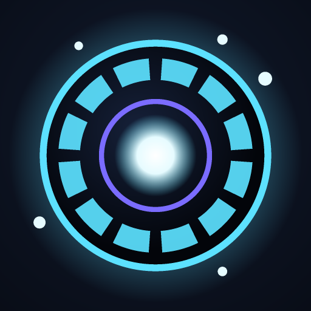

<p align="center"></p>

# ZED

**Website:** https://melhive.github.io/ZED/ · **Download:** https://github.com/melhive/ZED/releases/latest/download/zed.apk

**Think. Learn. Organize. Automate. Execute.**

ZED is a native Android personal AI assistant written in Kotlin with Jetpack Compose. It is useful with **no model and no internet**, gets smarter with an **on-device model** (Google LiteRT-LM, e.g. Gemma 4 E2B), and can optionally use **online providers** (Gemini, OpenAI, Claude, or any OpenAI-compatible endpoint).

## Highlights

- **Native intelligence (offline, no model):** files and folders, alarms, timers, calendar events, reminders, task list, memory, conversation search, settings and workflows through deterministic commands. Say `help` to see them.
- **On-device AI:** LiteRT-LM runtime with a verified model catalog (Gemma 4 E2B/E4B, Qwen3 0.6B), resumable SHA-256-checked downloads, import, CPU/GPU backends.
- **Online AI (optional):** provider-independent streaming layer; keys encrypted with Android Keystore.
- **Chat Mode:** persistent conversations, streaming replies, voice input, text attachments, tool execution with visible results.
- **ZED LIVE:** full-screen voice assistant with an animated orb driven by real events, sentence-streamed speech, barge-in with echo cancellation, mute/speaker/cancel controls.
- **Jarvis-style assistant (v0.1.12–0.1.13):** default digital assistant (hold power/home), Quick Settings tile, home widget, “Hey Zed” wake word, personalities, real-time voice with Gemini Live, phone control (calls, texts, apps, music, volume, flashlight, Do Not Disturb, navigation), “what did I miss?”, daily briefing with weather and calendar, routines (voice, time, Bluetooth triggers), camera vision and Home Assistant smart home. Online AI uses native multi-step tool calling.
- **Natural offline voices:** download realistic neural voices (Supertonic 3 and Kokoro, 38 voices, ~130 MB each) that run fully on the phone, or use any phone voice. Choose the voice, speaking speed and pitch in More → Voice.
- **Eye mode (v0.1.39):** ZED's two robotic owl eyes fill the screen in landscape. They move, blink and show feeling like living eyes, follow your face with the front camera, look at what you hold up and answer “what is this?” from what they see. Same conversation as LIVE; the camera runs only while Eye mode is open.
- **Guest mode on the lock screen (v0.1.41):** on a locked phone ZED answers general questions and sets timers, alarms, flashlight and volume; anything personal waits for the unlock, and nothing personal reaches the model.
- **Live Brain (v0.1.20):** Memory → Live Brain shows everything ZED knows as a glowing, moving knowledge graph — areas of life, memories, tasks, reminders, documents and conversations, linked by the names and ideas they share. Pinch, drag, tap, search.
- **Live Brain 2.0 (v0.1.21):** the brain is a 3D hologram you can turn and fly into; memories flash when ZED uses them, often-used ones glow near the core, and a time-lapse replays how it grew. A mini brain lives on Home, in LIVE and in the floating assistant.
- **Speed test and reports (v0.1.21):** measure first-word wait and words per second on your phone, and save a full report of any reply (what was asked, what ZED did, timings) to a file — nothing is sent anywhere.
- **Safety copies and weekly backup (v0.1.21):** ZED copies its database before an update changes its format, and can back up to a folder of your choice every week.
- **Backup & restore (v0.1.20):** one file holds your data and settings, and optionally the AI models, offline voices and (password-encrypted) API keys — restore it on the same phone or a new one.
- **Task engine:** WorkManager-backed background tasks (organize folders with plan approval, index documents, download models) with real progress, cancellation, retry, dependencies and conflict detection.
- **Local knowledge:** on-device document index (SQLite FTS4 + BM25) used as optional context.
- **Security first:** every action goes through validation → skill/capability checks → confirmation → execution → audit. AI output is treated as untrusted.

## Download

**On your Android phone, open:**

### 👉 https://github.com/melhive/ZED/releases/latest/download/zed.apk

Tap the downloaded file and choose **Install** (allow "Install unknown apps" for your browser the first time).

- This link always gives the **newest version** — share it with anyone.
- Updates install **over** the old version and keep your data. ZED also shows an **Update available** card when a new release is out.
- All versions: https://github.com/melhive/ZED/releases

## Documentation

| Document | Contents |
|---|---|
| [ARCHITECTURE.md](docs/ARCHITECTURE.md) | Modules, packages, intelligence layers, tool pipeline, task engine |
| [SECURITY.md](docs/SECURITY.md) | Security controls and permissions |
| [MODEL_SUPPORT.md](docs/MODEL_SUPPORT.md) | LiteRT-LM integration, verified models, online providers |
| [VOICE_MODE.md](docs/VOICE_MODE.md) | ZED LIVE pipeline and its limitations |
| [BUILDING.md](docs/BUILDING.md) | Remote builds, installing the APK, release signing |
| [ROADMAP.md](docs/ROADMAP.md) | Milestones and what's next |
| [DEVELOPMENT_STATUS.md](DEVELOPMENT_STATUS.md) | Current state, test results, known issues |

## Project layout

```
ZED/
├── core/      pure Kotlin: parser, tools, security, tasks, retrieval, VAD, prompts, skills (+ tests)
├── app/       Android app: UI, data, voice, models, providers, tasks, integrations (+ tests)
├── docs/      documentation
├── scripts/   test-core.sh (run core tests in Termux)
└── .github/workflows/  android-build.yml, release.yml
```

## Status

Actively developed. See [DEVELOPMENT_STATUS.md](DEVELOPMENT_STATUS.md) for what is verified, what only compiles, and what still needs testing on a physical device.
